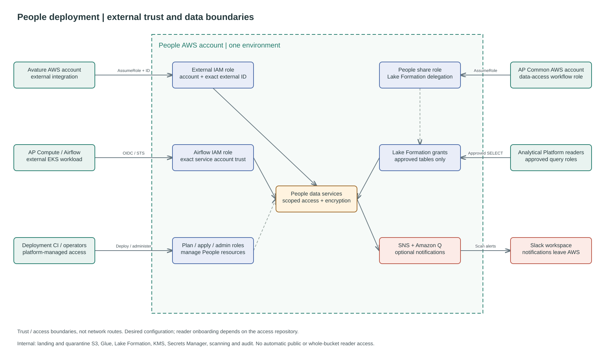
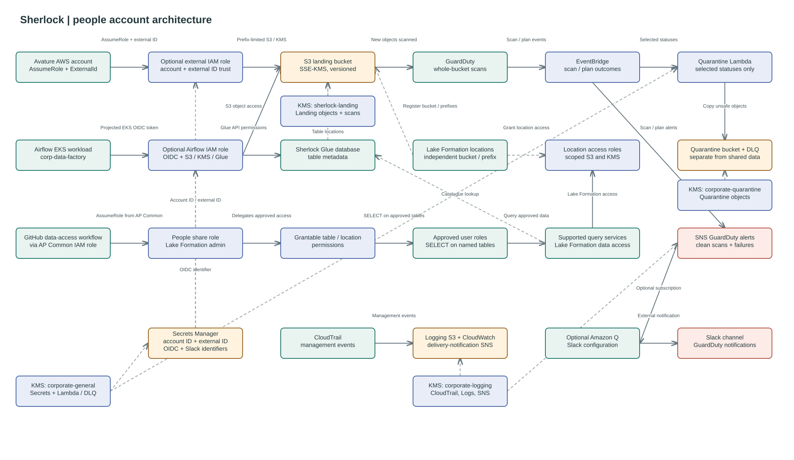

# Corporate Data Factory: Sherlock

This environment provides a secure landing bucket for data supplied by an external AWS account.

The data factory allows for:

- receiving data in an encrypted S3 landing bucket from an external AWS account
- limiting the external account to its allocated S3 prefix
- optionally allowing Airflow workflows to read and write landing-bucket objects using temporary credentials
- cataloging the data with AWS Glue
- scanning new S3 objects for malware with GuardDuty Malware Protection
- moving selected scan results to a quarantine bucket
- sending GuardDuty scan and protection plan alerts to Slack
- encrypting data and supporting services with customer-managed KMS keys
- recording AWS management activity with CloudTrail

## Configuration Layout

Terraform loads all top-level `.tf` files as one configuration.

| File | Responsibility |
| --- | --- |
| [main.tf](main.tf) | Shared settings, enable toggles and Airflow issuer lookup local |
| [airflow.tf](airflow.tf) | Airflow secret, OIDC provider, workload role, IAM policies and Lake Formation grants |
| [external-access.tf](external-access.tf) | External-account secret, assumed role and its Lake Formation grants |
| [catalogue.tf](catalogue.tf) | Glue database, lake formation location map, registration module calls, Lake Formation administrators |
| [lakeformation-share-role.tf](lakeformation-share-role.tf) | data-engineering-datalake-access workflow role and grantable table/location access |
| [storage.tf](storage.tf) | Landing and quarantine buckets |
| [kms.tf](kms.tf) | Separate landing, general, quarantine and logging keys |
| [monitoring.tf](monitoring.tf) | CloudTrail, GuardDuty scanning, EventBridge alerts and quarantine Lambda |
| [chatbot.tf](chatbot.tf) | Optional Slack integration and its configuration secret |

## Airflow Access

[airflow.tf](airflow.tf) always creates an empty, KMS-encrypted authentication secret. The `enable_airflow_iam_role` local in [main.tf](main.tf) is currently `true` and controls the secret-value lookup, Analytical Platform Compute OIDC provider, Airflow data-ingestion role and its Lake Formation grants. For initial setup, start with it set to `false`.

### Setup

Use two applies, with a manual secret update between them:

1. Set `enable_airflow_iam_role = false` in [main.tf](main.tf), then plan and apply. This creates the KMS-encrypted secret `external/analytical_platform/airflow_authentication` without a value, skipping the value lookup, OIDC provider and role.
2. From the cluster's OpenID Connect provider URL, take only the value after `/id/`, not the cluster ARN or full URL. Populate the secret in the target AWS account in `eu-west-2` with:

    ```json
    {"oidc_cluster_identifier":"<value-after-/id/>"}
    ```
3. Set `enable_airflow_iam_role = true`, then plan and apply again to create the OIDC provider and role. Keep it enabled afterwards; setting it back to `false` plans to destroy the role and OIDC provider, but retains the secret and its value.

### Trust And Permissions

The role derives the trusted service account from the Airflow project (`corp`) and workflow (`data-factory`). Development, test and production trust exactly `system:serviceaccount:mwaa:corp-data-factory`. Preproduction appends `-pp` to the project prefix, trusting `system:serviceaccount:mwaa:corp-pp-data-factory`. 

The module names the role `airflow-<dev|test|prod>-data-ingestion`, with `-pp` appended for preproduction. Workloads receive temporary credentials through `sts:AssumeRoleWithWebIdentity`.

The role currently grants:

- `s3:ListAllMyBuckets` on `*` to list account bucket names, without granting access to their contents.
- `s3:ListBucket` on the Sherlock landing bucket to list keys across all prefixes.
- `s3:GetObject` and `s3:PutObject` across all prefixes in the Sherlock landing bucket, unlike the prefix-restricted external role.
- `kms:Decrypt` and `kms:GenerateDataKey` on the Sherlock landing key, only through S3 in the deployment region.

It also grants `glue:GetDatabase`, `glue:GetTable`, `glue:CreateTable` and `glue:UpdateTable` on the Sherlock catalogue resources. Separate Lake Formation grants allow database `DESCRIBE`/`CREATE_TABLE` and table `DESCRIBE`/`ALTER` within Sherlock. IAM and Lake Formation permissions are separate checks.

It does not grant object deletion, access to older object versions or quarantine-bucket object access.

## Architecture

### External Boundaries



[Editable boundary diagram](boundaries.excalidraw).

### Detailed Overview



[Editable Excalidraw overview](architecture.excalidraw). 

The Airflow secret is always created; its OIDC provider and role are only created when `enable_airflow_iam_role = true`. Dashed connections show configuration and encryption relationships rather than object transfers.

## Catalogue And Registered Storage

The [Glue database module](modules/glue-database/README.md) only creates catalogue
metadata. Its default S3 location is `avature-sherlock-<environment>` in the
landing bucket. Each table may use its own location, including another bucket.
Creating a table does not register its storage or grant query access.

The [Lake Formation location module](modules/lakeformation-location/README.md)
separately registers a bucket or prefix and creates the S3/KMS access role used
by Lake Formation. The `lakeformation_locations` map in [catalogue.tf](catalogue.tf)
currently contains one `sherlock` entry with `prefix = ""`, registering the whole
landing bucket, including future prefixes. Quarantine is not
included. 

To add another approved location:

1. Add a uniquely keyed map entry with `bucket_name`, `prefix`, `kms_key_arn` and
    a unique `role_name`. Use an empty prefix for a whole bucket, or a specific
    prefix for a narrower registration. Each entry can use a different key.
2. Ensure the bucket and key policies permit the location role's access. Its IAM
    policy grants scoped S3 listing, object read/write and use of that KMS key.
3. Do not overlap a bucket-root registration with another entry beneath it.
    Keep existing map keys stable: they form part of Terraform resource addresses.
4.   A Glue database can contain tables whose S3 locations differ from its default
    location. The share role's grantable location permissions follow the map, but
    table access still needs explicit approval in the access repo.

Registration does not automatically grant users access to rows. Table `SELECT`
permissions govern Lake Formation queries; `DATA_LOCATION_ACCESS` instead permits
catalogue operations that reference registered storage. Direct S3 clients such
as Airflow use their own IAM and KMS permissions independently.

### Data Access Workflow

[lakeformation-share-role.tf](lakeformation-share-role.tf) creates
`analytical-platform-data-production-share-role` in each People environment. 
Authentication chains from the AP Common `data-engineering-datalake-access-github-actions`
role using `sts:AssumeRole`.

The share role is a Lake Formation administrator, has the AWS-managed
`AWSLakeFormationCrossAccountManager` and `AWSLakeFormationDataAdmin` IAM policies,
and receives grantable `DESCRIBE`/`SELECT` on Sherlock tables and grantable
`DATA_LOCATION_ACCESS` on the explicitly registered locations. These are workflow
permissions to delegate access.

The AP Common assume-role allow-list must include the People share-role ARN.

## Process

### 1. An external account is trusted

The account ID stored in the `sherlock-external-account-id` Secrets Manager secret is used to create the trust relationship for `datafactory_<environment>_assume_role`.

The role also requires the exact STS external ID stored in the KMS-encrypted
`sherlock-external-id` secret. Its value is populated outside Terraform, not
hard-coded in configuration. Avature must pass it as `ExternalId` in every
`AssumeRole` request.

Setup uses two full CI/CD plans and applies, with manual secret population
between deployments.

1. Set `enable_external_iam_role = false` in [main.tf](main.tf), then run 
    plan and apply. Terraform creates any missing secret containers and
    skips both value lookups. If the role already exists, this destroys the
    external role, its inline policy and its Lake Formation grants. The secrets
    and any existing values are retained.
2. Populate `sherlock-external-account-id`, if it has no value, with the
    trusted external account's 12-digit account ID as plain text.
    Populate `sherlock-external-id` with the agreed external ID as plain text,
    without quotes or a trailing newline.
3. Ensure Avature includes the matching `ExternalId` in its STS `AssumeRole`
    request before re-enabling access. The identifier must contain 2 to 1,224
    supported characters; empty values, whitespace and wildcards are rejected.
4. Set `enable_external_iam_role = true` in [main.tf](main.tf), then run plan
    and apply to recreate the role, inline policy and Lake Formation
    grants using the populated secrets. Missing or invalid values fail rather
    than removing the external ID condition.
    Keep it enabled for subsequent deployments; setting it back to `false`
    will plan to destroy the external role and its grants again.

The module input is marked sensitive to reduce accidental plan output, but the
value is still stored in Terraform state and the IAM role's trust policy. AWS
external IDs are not passwords or secrets; authorised IAM policy readers can
view them.

The external account does not receive permanent credentials. A principal in that account assumes the role and receives temporary credentials.

The role is restricted to:

- the `avature-sherlock` prefix in the landing bucket
- `GetObject`, `PutObject`, and `ListBucket` operations for that area
- the Sherlock KMS key for encryption and decryption
- the Sherlock Glue database and its tables

### 2. Data arrives in the landing bucket

The landing bucket name uses an account-regional namespace and includes the AWS account ID and region.

The bucket uses:

- SSE-KMS encryption customer managed key
- bucket-owner-enforced object ownership
- versioning
- public access protection from the shared S3 module
- no cross-region replication

The Glue database's default location is `avature-sherlock-<environment>`. The external uploader's S3 scope is separately configured as `avature-sherlock/`; these are distinct prefixes. A table can specify another S3 location rather than inheriting the database default.

### 3. GuardDuty scans new objects

When a new object is created, GuardDuty Malware Protection scans it and writes the scan result back to the object as tags.

GuardDuty also publishes a scan result event to the default EventBridge bus.

The GuardDuty configuration is in [modules/guardduty-malware-scan/main.tf](modules/guardduty-malware-scan/main.tf).

### 4. EventBridge starts the quarantine workflow

The EventBridge module creates three rules, all scoped to the landing bucket:

- `eventbridge-malware-rule` sends matching object scan results to
    `guardduty_lambda`.
- `eventbridge-malware-rule-alerts` publishes configured scan results to the
    GuardDuty SNS alerts topic.
- `eventbridge-malware-rule-plan-alerts` publishes Malware Protection plan
    warnings and errors to the same topic, independently of object scan status.

Both scan-result rules currently match:

```text
THREATS_FOUND
FAILED
ACCESS_DENIED
UNSUPPORTED
NO_THREATS_FOUND
```

The scan-alert rule and plan-alert rule publish custom notifications to the
GuardDuty SNS topic. The configured Amazon Q subscription forwards these to the
`data-factory-corporate-alerts` Slack channel. The alerts rule and Lambda rule
have separate status lists, even though they currently contain the same five
scan statuses.

To set up Slack notifications:

1. Authorise the MoJ Slack workspace in Amazon Q Developer in chat applications
    for this AWS account.
2. Plan and apply with `enable_guardduty_slack_notifications` in the `locals`
    block in [main.tf](main.tf) left at `false`. Terraform creates the KMS-encrypted Secrets Manager
    secret `corporate-guardduty-slack-config` as an empty secret.
3. Add a value to the new secret in this AWS account and region containing the
    authorised Slack workspace ID and destination channel ID:
    ```json
    {"slack_team_id":"T...","slack_channel_id":"C..."}
    ```
4. Set `enable_guardduty_slack_notifications = true` in the `locals` block in
    [main.tf](main.tf), then plan and apply again. Keep it enabled for subsequent
    deployments; setting it back to `false` will plan to destroy the Slack configuration.

See [modernisation-platform-terraform-aws-chatbot](https://github.com/ministryofjustice/modernisation-platform-terraform-aws-chatbot/).

### 5. Lambda quarantines selected objects

The Lambda reads the bucket, object key, and scan status from the EventBridge event.
It adds `classification=official-sensitive` to each object delivered to it,
preserving existing tags. `NO_THREATS_FOUND` is included in the Lambda rule's
status list, so clean scans are tagged too.

For a status in `QUARANTINE_STATUSES`, it:

1. copies the object to the quarantine bucket using the KMS key
2. deletes the original object from the landing bucket
3. writes details to its CloudWatch log stream

If the Lambda invocation fails, the event is sent to the `guardduty_lambda-dlq` SQS dead-letter queue.

The function code is in [modules/guardduty-lambda/src/lambda.py](modules/guardduty-lambda/src/lambda.py).

### 6. CloudTrail provides the audit trail

The `corporate-cloudtrail` trail is configured as a multi-region trail and includes global service events.

It sends:

- CloudTrail log files to the encrypted logging S3 bucket
- event records to the `/aws/cloudtrail/corporate-cloudtrail` CloudWatch log group
- log delivery notifications to the `corporate-cloudtrail-notifications` SNS topic

The CloudWatch log group retains records for 365 days. The S3 logging bucket is versioned and uses the corporate logging KMS key.

This trail records AWS management activity by default. It does not currently enable S3 object-level data events, so it will not record every individual file upload, download, or deletion. That would require an `event_selector` or `advanced_event_selector`.

The configuration is in [modules/logging-bucket-cloudtrail/main.tf](modules/logging-bucket-cloudtrail/main.tf).


## Resource map

| Terraform module | AWS resources or purpose |
| --- | --- |
| [sherlock_kms_key](modules/kms-key/README.md) | Customer-managed KMS key and alias `sherlock-landing` used by authorised landing-bucket clients and the Lake Formation storage role |
| `corporate_general_kms_key` | Customer-managed KMS key and alias `corporate-general` for the secrets, Lambda environment variables and dead-letter queue |
| `corporate_quarantine_kms_key` | Customer-managed KMS key and alias `corporate-quarantine` for the quarantine bucket |
| `corporate_logging_kms_key` | Customer-managed KMS key and alias `corporate-logging` for CloudTrail, the logging bucket, the log group and SNS topics |
| `sherlock_landing_bucket_mp` | Encrypted, versioned S3 landing bucket |
| `sherlock_quarantine_bucket` | Encrypted S3 quarantine bucket |
| [corp_people_logging_bucket](modules/logging-bucket-cloudtrail/README.md) | CloudTrail, logging S3 bucket, CloudWatch log group, SNS topic |
| [sherlock_glue_database](modules/glue-database/README.md) | Glue database metadata and default landing prefix, independent of storage registration |
| [lakeformation_locations](modules/lakeformation-location/README.md) | One Lake Formation registration, service role and scoped S3/KMS policy per bucket or prefix |
| [assume_iam_role](modules/external-iam-role/README.md) | Trusted external role and scoped S3, KMS, and Glue permissions |
| [data_factory_guardduty_scan](modules/guardduty-malware-scan/README.md) | GuardDuty Malware Protection plan |
| [data_factory_guardduty_eventbridge](modules/guardduty-eventbridge/README.md) | Quarantine and alert EventBridge rules, Lambda target, and SNS topic |
| [data_factory_guardduty_lambda](modules/guardduty-lambda/README.md) | Quarantine Lambda and SQS dead-letter queue |
| `guardduty_chatbot` | Optional Amazon Q Developer Slack channel configuration using Secrets Manager IDs |
| [data_platform_airflow_iam_role](modules/airflow-iam-role/README.md) | Optional workload role with OIDC trust and caller-supplied S3, KMS and Glue policies; Lake Formation grants are defined separately |
| Airflow resources in [airflow.tf](airflow.tf) | Always-created authentication secret encrypted with `corporate_general_kms_key`; optional IAM OIDC provider |

## Documentation And Diagrams

The diagrams are generated locally from [diagram-tools/generate.mjs](diagram-tools/generate.mjs).
From the People directory, run `node diagram-tools/generate.mjs` for all scenes,
or pass a directory such as `modules/lakeformation-location` to render one.
Each diagram has an editable `.excalidraw` JSON scene and an SVG preview for
Markdown. Diagram generation uses Node.js built-in modules and does not apply
Terraform or contact AWS.

Module reference tables are generated with `terraform-docs markdown table` and
injected between each README's Terraform-docs markers. Keep the existing marker
style when refreshing them, and review prose and diagrams when behaviour changes.


