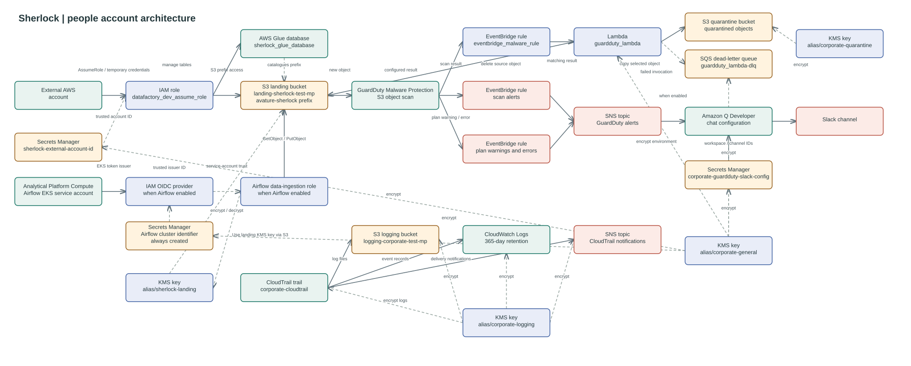

# Corporate Data Factory: Sherlock

This environment provides a secure landing bucket for data supplied by an external AWS account.

The data factory allows for:

- receiving data in an encrypted S3 landing bucket from an external aws account
- limiting the external account to its allocated S3 prefix
- optionally allowing Airflow workflows to read and write landing-bucket objects using temporary credentials
- allowing the user to catalogue the data with AWS Glue
- scanning new S3 objects for malware with GuardDuty Malware Protection
- moving selected scan results to a quarantine bucket
- sending GuardDuty scan and protection plan alerts to Slack
- encrypting data and supporting services with customer-managed KMS keys
- recording AWS management activity with CloudTrail

## Airflow Access

[airflow.tf](airflow.tf) always creates an empty, KMS-encrypted authentication secret. The `enable_airflow_iam_role` toggle defaults to `false` and controls the secret-value lookup, Analytical Platform Compute OIDC provider and Airflow data-ingestion role.

### Setup

Use two applies, with a manual secret update between them:

1. Leave `enable_airflow_iam_role = false` in [airflow.tf](airflow.tf), then plan and apply. This creates the KMS-encrypted secret `external/analytical_platform/airflow_authentication` without a value, skipping the value lookup, OIDC provider and role.
2. From the cluster's OpenID Connect provider URL, take only the value after `/id/`, not the cluster ARN or full URL. Populate the secret in the target AWS account in `eu-west-2` with:

    ```json
    {"oidc_cluster_identifier":"<value-after-/id/>"}
    ```
3. Set `enable_airflow_iam_role = true`, then plan and apply again to create the OIDC provider and role. Keep it enabled afterwards; setting it back to `false` plans to destroy the role and OIDC provider, but retains the secret and its value.

### Trust And Permissions

The role trusts the Kubernetes service account `data-factory-corporate-data-ingestion` in the `mwaa` namespace. Preproduction appends `-pp` to the service-account name. 

The module names the role `airflow-<dev|test|prod>-data-ingestion`, with `-pp` appended for preproduction. Workloads receive temporary credentials through `sts:AssumeRoleWithWebIdentity`, not static access keys.

The role grants:

- `s3:ListBucket` on the Sherlock landing bucket to list keys across all prefixes.
- `s3:GetObject` and `s3:PutObject` across all prefixes in the Sherlock landing bucket, unlike the prefix-restricted external role.
- `kms:Decrypt` and `kms:GenerateDataKey` on the Sherlock landing key, only through S3 in the deployment region.

It does not grant object deletion, access to older object versions, Glue access or quarantine-bucket access.

## Architecture



The Airflow secret is always created; its OIDC provider and role are only created when `enable_airflow_iam_role = true`. Dashed connections show configuration and encryption relationships rather than object transfers.

## Process

### 1. An external account is trusted

The account ID stored in the `sherlock-external-account-id` Secrets Manager secret is used to create the trust relationship for `datafactory_dev_assume_role`.

The secret and role require a staged deployment:

1. Plan and apply with `enable_external_iam_role` in the `locals` block in
    [main.tf](main.tf) left at `false`.
    Terraform creates the secret without a value and skips the secret lookups and
    external role.
2. Populate `sherlock-external-account-id` in the target AWS account and region with the
    trusted external account's 12-digit account ID as plain text, not JSON.
3. Set `enable_external_iam_role = true` in the `locals` block in
    [main.tf](main.tf), then plan and apply again to create the role.
    Keep it enabled for subsequent deployments; setting it back to `false`
    will plan to destroy the external role.

The external account does not receive permanent credentials. A principal in that account assumes the role and receives temporary credentials.

The role is restricted to:

- the `avature-sherlock` prefix in the landing bucket
- `GetObject`, `PutObject`, and `ListBucket` operations for that area
- the Sherlock KMS key for encryption and decryption
- the Sherlock Glue database and its tables

It does not grant access to the whole landing bucket or the quarantine bucket.

### 2. Data arrives in the landing bucket

The landing bucket is created with a prefix using aws reccomended naming convention, the final bucket name also includes the AWS account ID and region.

The bucket uses:

- SSE-KMS encryption customer managed key
- bucket-owner-enforced object ownership
- versioning
- public access protection from the shared S3 module
- no cross-region replication

The Glue database points at the `avature-sherlock` prefix. Avature can add glue tables for their data.

### 3. GuardDuty scans new objects

The GuardDuty Malware Protection plan protects the landing bucket. When a new object is created, GuardDuty scans it and writes the scan result back to the object as tags.

GuardDuty also publishes a scan result event to the default EventBridge bus.

The GuardDuty configuration is in [modules/guardduty-malware-scan/main.tf](modules/guardduty-malware-scan/main.tf).

### 4. EventBridge starts the quarantine workflow

The `eventbridge_malware_rule` rule listens for GuardDuty Malware Protection object scan results for the landing bucket.

It sends matching events to `guardduty_lambda`. The rule is defined in [modules/guardduty-eventbridge/main.tf](modules/guardduty-eventbridge/main.tf).

The current configuration matches these statuses:

```text
THREATS_FOUND
FAILED
ACCESS_DENIED
UNSUPPORTED
NO_THREATS_FOUND
```

The same scan results and protection plan warnings/errors are published to the
GuardDuty alerts SNS topic. To receive them in Slack:

1. Authorise the MoJ Slack workspace in Amazon Q Developer in chat applications
    for this AWS account.
2. Plan and apply with `enable_guardduty_slack_notifications` in the `locals`
    block in [main.tf](main.tf) left at `false`. Terraform creates the KMS-encrypted Secrets Manager
    secret `corporate-guardduty-slack-config` as an empty secret.
3. Add a value to the new secret in this AWS account and region containing the
    authorised Slack workspace ID and destination channel ID:
    ```json
    {"slack_team_id":"T...","slack_channel_id":"C..."}
    ```
4. Set `enable_guardduty_slack_notifications = true` in the `locals` block in
    [main.tf](main.tf), then plan and apply again. Keep it enabled for subsequent
    deployments; setting it back to `false` will plan to destroy the Slack configuration.

See [modernisation-platform-terraform-aws-chatbot](https://github.com/ministryofjustice/modernisation-platform-terraform-aws-chatbot/).

### 5. Lambda quarantines selected objects

The Lambda reads the bucket, object key, and scan status from the EventBridge event.

For a status in `QUARANTINE_STATUSES`, it:

1. copies the object to the quarantine bucket using the KMS key
2. deletes the original object from the landing bucket
3. writes details to its CloudWatch log stream

If the Lambda invocation fails, the event is sent to the `guardduty_lambda-dlq` SQS dead-letter queue.

The function code is in [modules/guardduty-lambda/src/lambda.py](modules/guardduty-lambda/src/lambda.py).

All five scan outcomes are sent to Slack. Only `THREATS_FOUND`, `FAILED`,
`ACCESS_DENIED`, and `UNSUPPORTED` invoke the quarantine Lambda and trigger
quarantine. Clean scans (`NO_THREATS_FOUND`) do not invoke the Lambda.

### 6. CloudTrail provides the audit trail

The `corporate-cloudtrail` trail is configured as a multi-region trail and includes global service events.

It sends:

- CloudTrail log files to the encrypted logging S3 bucket
- event records to the `/aws/cloudtrail/corporate-cloudtrail` CloudWatch log group
- log delivery notifications to the `corporate-cloudtrail-notifications` SNS topic

The CloudWatch log group retains records for 365 days. The S3 logging bucket is versioned and uses the corporate logging KMS key.

This trail records AWS management activity by default. It does not currently enable S3 object-level data events, so it will not record every individual file upload, download, or deletion. That would require an `event_selector` or `advanced_event_selector`.

The configuration is in [modules/logging-bucket-cloudtrail/main.tf](modules/logging-bucket-cloudtrail/main.tf).


## Resource map

| Terraform module | AWS resources or purpose |
| --- | --- |
| [sherlock_kms_key](modules/kms-key/README.md) | Customer-managed KMS key and alias `sherlock-landing` for the landing bucket, Glue storage and external role, shared with the external account |
| `corporate_general_kms_key` | Customer-managed KMS key and alias `corporate-general` for the secrets, Lambda environment variables and dead-letter queue |
| `corporate_quarantine_kms_key` | Customer-managed KMS key and alias `corporate-quarantine` for the quarantine bucket |
| `corporate_logging_kms_key` | Customer-managed KMS key and alias `corporate-logging` for CloudTrail, the logging bucket, the log group and SNS topics |
| `sherlock_landing_bucket_mp` | Encrypted, versioned S3 landing bucket |
| `sherlock_quarantine_bucket` | Encrypted S3 quarantine bucket |
| [corp_people_logging_bucket](modules/logging-bucket-cloudtrail/README.md) | CloudTrail, logging S3 bucket, CloudWatch log group, SNS topic |
| `sherlock_glue_database` | Glue database for the landing prefix |
| [assume_iam_role](modules/external-iam-role/README.md) | Trusted external role and scoped S3, KMS, and Glue permissions |
| [data_factory_guardduty_scan](modules/guardduty-malware-scan/README.md) | GuardDuty Malware Protection plan |
| [data_factory_guardduty_eventbridge](modules/guardduty-eventbridge/README.md) | Quarantine and alert EventBridge rules, Lambda target, and SNS topic |
| [data_factory_guardduty_lambda](modules/guardduty-lambda/README.md) | Quarantine Lambda and SQS dead-letter queue |
| `guardduty_chatbot` | Optional Amazon Q Developer Slack channel configuration using Secrets Manager IDs |
| `data_platform_airflow_iam_role` | Optional Airflow role with OIDC trust, landing-object access and scoped KMS permissions |
| Airflow resources in [airflow.tf](airflow.tf) | Always-created authentication secret encrypted with `corporate_general_kms_key`; optional IAM OIDC provider |


