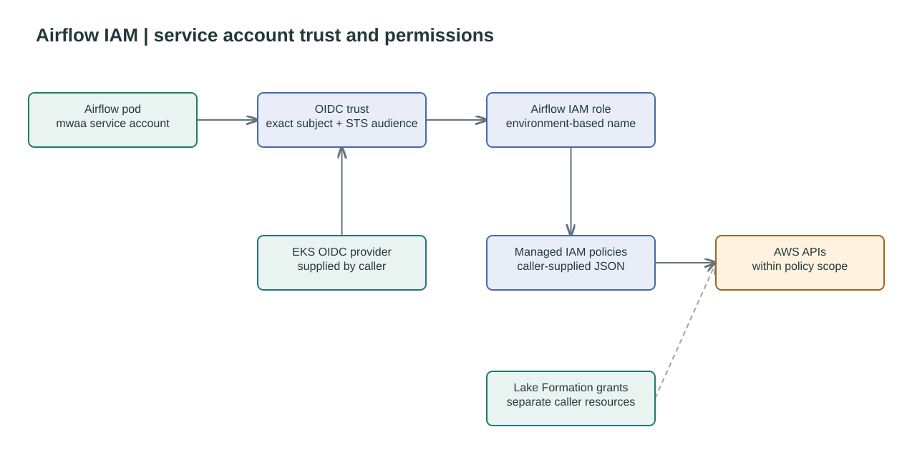

# Airflow IAM Role

Creates an IAM role trusted by one Kubernetes service account in the `mwaa`
namespace, plus one managed IAM policy and attachment per `iam_policy_documents`
entry. The caller supplies the OIDC provider and permission documents; this
module does not create the provider, service account, S3 resources or Lake
Formation grants.

## Architecture

[Editable Excalidraw diagram](architecture.excalidraw).

## Naming And Trust

For project `corp`, workflow `data-factory` and role suffix `data-ingestion`:

| Environment | IAM role | Trusted service account in `mwaa` |
| --- | --- | --- |
| development | `airflow-dev-data-ingestion` | `corp-data-factory` |
| test | `airflow-test-data-ingestion` | `corp-data-factory` |
| preproduction | `airflow-prod-data-ingestion-pp` | `corp-pp-data-factory` |
| production | `airflow-prod-data-ingestion` | `corp-data-factory` |

Trust requires exact `sub = system:serviceaccount:<namespace>:<service-account>`
and `aud = sts.amazonaws.com`. The issuer condition keys currently use the EKS
OIDC endpoint in `eu-west-2`; the supplied provider and identifier must match the
cluster that runs the workload. No wildcard subject is granted.

## Usage

See the complete [People caller](../../airflow.tf). Set `airflow_project`,
`airflow_workflow`, `environment`, `role_name_suffix`, `role_description`,
`oidc_arn` and `oidc_cluster_identifier`. Pass JSON IAM policies in
`iam_policy_documents`; omitting them creates a trusted role with no managed
permission policies from this module. The default maximum session is 3,600 seconds.

The role ARN output is also suitable as the principal for separate Lake Formation
grants. Glue IAM permissions alone do not grant access to Lake Formation-governed
databases and tables. KMS-encrypted S3 objects additionally require key access.

## State And Verification

Adapted from the public `ministryofjustice/terraform-aws-moj-data-factory-modules`
Airflow module at `872286b442431969ac3bb8b44410c3e7a53b5c4e`. Resource labels are
retained for the existing People module address. Keep the parent module label,
count and policy ordering stable when migrating: policy names use list indices.
Run `terraform init` after changing the source and review the plan before applying.

From this directory, run `terraform init -backend=false`, `terraform validate`
and `terraform test`. Tests use the module's Terraform test configuration and
are not a substitute for checking the deployed issuer and service account.

<!--BEGIN_TF_DOCS-->
## Requirements

| Name | Version |
| ---- | ------- |
|  [terraform](#requirement\_terraform) | >= 1.5 |
|  [aws](#requirement\_aws) | ~> 6.0 |

## Providers

| Name | Version |
| ---- | ------- |
|  [aws](#provider\_aws) | ~> 6.0 |

## Modules

No modules.

## Resources

| Name | Type |
| ---- | ---- |
| [aws_iam_policy.airflow_role](https://registry.terraform.io/providers/hashicorp/aws/latest/docs/resources/iam_policy) | resource |
| [aws_iam_role.airflow_role](https://registry.terraform.io/providers/hashicorp/aws/latest/docs/resources/iam_role) | resource |
| [aws_iam_role_policy_attachment.airflow_role](https://registry.terraform.io/providers/hashicorp/aws/latest/docs/resources/iam_role_policy_attachment) | resource |
| [aws_iam_policy_document.oidc_assume_role_policy](https://registry.terraform.io/providers/hashicorp/aws/latest/docs/data-sources/iam_policy_document) | data source |

## Inputs

| Name | Description | Type | Default | Required |
| ---- | ----------- | ---- | ------- | :------: |
|  [airflow\_project](#input\_airflow\_project) | Airflow project prefix used in the MWAA service account name | `string` | n/a | yes |
|  [airflow\_workflow](#input\_airflow\_workflow) | Airflow workflow used in the MWAA service account name | `string` | n/a | yes |
|  [environment](#input\_environment) | Deployment environment name | `string` | n/a | yes |
|  [iam\_policy\_documents](#input\_iam\_policy\_documents) | List of IAM policy JSON documents to create and attach to the role | `list(string)` | `[]` | no |
|  [max\_session\_duration](#input\_max\_session\_duration) | Maximum session duration in seconds | `number` | `3600` | no |
|  [oidc\_arn](#input\_oidc\_arn) | ARN of the OIDC identity provider | `string` | n/a | yes |
|  [oidc\_cluster\_identifier](#input\_oidc\_cluster\_identifier) | OIDC cluster identifier used in condition keys | `string` | n/a | yes |
|  [role\_description](#input\_role\_description) | Description of the IAM role | `string` | n/a | yes |
|  [role\_name\_suffix](#input\_role\_name\_suffix) | Suffix used when constructing the IAM role name | `string` | n/a | yes |

## Outputs

| Name | Description |
| ---- | ----------- |
|  [role\_arn](#output\_role\_arn) | ARN of the IAM role |
|  [role\_name](#output\_role\_name) | Name of the IAM role |
|  [role\_unique\_id](#output\_role\_unique\_id) | Stable and unique string identifying the IAM role |
<!--END_TF_DOCS-->