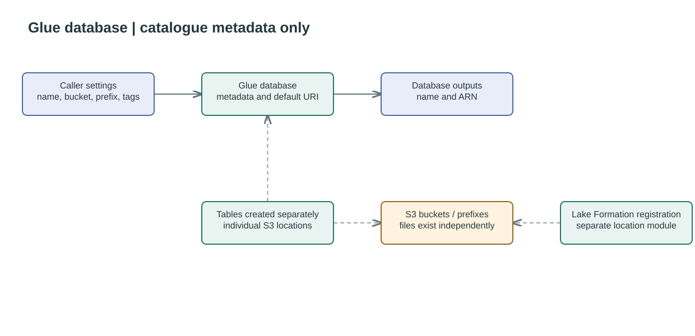

# Glue Database

Creates one AWS Glue catalogue database with a default S3 location and tags.

## Architecture

[Editable Excalidraw diagram](architecture.excalidraw).

## Usage

The [People caller](../../catalogue.tf) supplies:

| Setting | People value |
| --- | --- |
| `database_name` | `sherlock_glue_database_<environment>` |
| `storage.bucket_name` | Sherlock landing bucket name |
| `storage.prefix` | `avature-sherlock-<environment>` |

`storage.prefix` must be non-empty and must not begin with `/`. Trailing slashes
are trimmed when composing `s3://<bucket>/<prefix>`. The database name must be
shorter than 50 characters. A `Name` tag is generated in addition to caller tags.

The default location is metadata, not an access boundary. Individual tables can
point at different prefixes or buckets. Register approved storage independently
using the [Lake Formation location module](../lakeformation-location/README.md),
and grant catalogue permissions separately. Writing files or registering storage
does not automatically create Glue tables.

## Migration And Verification

Adapted from the public `ministryofjustice/terraform-aws-moj-data-factory-modules`
database module at `75a5fd1ccb6c1858508b98651030cc4c919b9d03`. The database resource
label and output names are retained. The former storage role, policy and location
registration now belong to the separate location module; the People root has
`moved` blocks for their existing addresses. Preserve those blocks and review a
plan against each environment's state before applying. Changing a registered
location ARN may still require replacement, even when its state address is moved.

From this directory, run `terraform init -backend=false`, `terraform validate`
and `terraform test`.

<!--BEGIN_TF_DOCS-->
## Requirements

| Name | Version |
| ---- | ------- |
|  [terraform](#requirement\_terraform) | >= 1.5 |
|  [aws](#requirement\_aws) | ~> 6.0 |

## Providers

| Name | Version |
| ---- | ------- |
|  [aws](#provider\_aws) | 6.73.0 |

## Modules

No modules.

## Resources

| Name | Type |
| ---- | ---- |
| [aws_glue_catalog_database.data_factory_database](https://registry.terraform.io/providers/hashicorp/aws/latest/docs/resources/glue_catalog_database) | resource |

## Inputs

| Name | Description | Type | Default | Required |
| ---- | ----------- | ---- | ------- | :------: |
|  [database\_name](#input\_database\_name) | The name of the Glue catalog database to create. | `string` | n/a | yes |
|  [storage](#input\_storage) | Database default S3 location; Lake Formation registration is managed separately. | <pre>object({     bucket_name = string     prefix      = string   })</pre> | n/a | yes |
|  [tags](#input\_tags) | Tags to apply to created resources. | `map(string)` | `{}` | no |

## Outputs

| Name | Description |
| ---- | ----------- |
|  [glue\_database\_arn](#output\_glue\_database\_arn) | The ARN of the Glue database |
|  [glue\_database\_name](#output\_glue\_database\_name) | The name of the Glue database |
<!--END_TF_DOCS-->