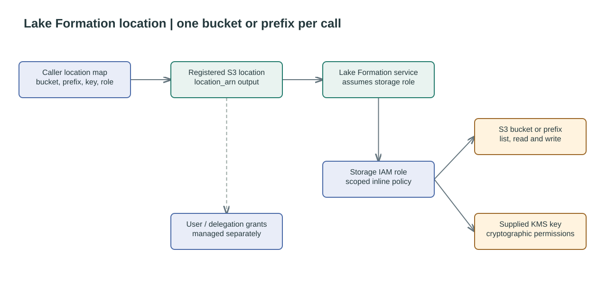

# Lake Formation Location

Registers one S3 bucket or prefix with Lake Formation and creates the IAM role
and inline policy Lake Formation uses to access that storage. Call the module
once per bucket or non-overlapping prefix, using a distinct `role_name`.

## Architecture

[Editable Excalidraw diagram](architecture.excalidraw).

## Scope And Permissions

| `prefix` | Registered location | S3 access |
| --- | --- | --- |
| `""` (default) | `arn:aws:s3:::<bucket>` | List the bucket; read/write all object prefixes |
| `"approved/data"` | `arn:aws:s3:::<bucket>/approved/data` | List only that prefix; read/write its objects |

Leading and trailing `/` characters are trimmed. The access role trusts only
`lakeformation.amazonaws.com`. It allows `s3:ListBucket`, `s3:GetObject` and
`s3:PutObject` within the configured scope, but no object deletion. KMS permissions
are `Decrypt`, `Encrypt`, `GenerateDataKey*` and `DescribeKey` on the supplied key.
The key policy and bucket policy must also permit the access; this module does
not edit those policies. Objects encrypted with another key need separate access.

Do not configure overlapping registrations, such as a bucket root and a child
prefix in the same bucket. Review existing AWS registrations before deployment.

## Multiple Buckets And Prefixes

In [the People catalogue configuration](../../catalogue.tf), add an entry to
`local.lakeformation_locations` for each location. Every entry supplies
`bucket_name`, `prefix`, `kms_key_arn` and a unique `role_name`. Entries can refer
to different buckets and encryption keys. The current `sherlock` entry has an
empty prefix and therefore covers the whole landing bucket, including future
prefixes. Do not register the Quarantine bucket.

One Glue database can reference multiple registered locations. Do not call
the database module again merely to register another bucket. Registration does
not create Glue tables, grant users `SELECT`, or prevent access through separately
authorised direct S3 clients. `DATA_LOCATION_ACCESS` controls catalogue operations
referencing registered storage, not permission to read table rows.

The `location_arn` output is available after registration and can be used in a
separate `aws_lakeformation_permissions` data-location grant.

<!--BEGIN_TF_DOCS-->
## Requirements

| Name | Version |
| ---- | ------- |
|  [terraform](#requirement\_terraform) | >= 1.5 |
|  [aws](#requirement\_aws) | ~> 6.0 |

## Providers

| Name | Version |
| ---- | ------- |
|  [aws](#provider\_aws) | 6.73.0 |

## Modules

No modules.

## Resources

| Name | Type |
| ---- | ---- |
| [aws_iam_role.lakeformation_s3_access_role](https://registry.terraform.io/providers/hashicorp/aws/latest/docs/resources/iam_role) | resource |
| [aws_iam_role_policy.lakeformation_s3_access_policy](https://registry.terraform.io/providers/hashicorp/aws/latest/docs/resources/iam_role_policy) | resource |
| [aws_lakeformation_resource.s3_location](https://registry.terraform.io/providers/hashicorp/aws/latest/docs/resources/lakeformation_resource) | resource |

## Inputs

| Name | Description | Type | Default | Required |
| ---- | ----------- | ---- | ------- | :------: |
|  [bucket\_name](#input\_bucket\_name) | Name of the bucket to register with Lake Formation. | `string` | n/a | yes |
|  [kms\_key\_arn](#input\_kms\_key\_arn) | KMS key used to encrypt objects at this location. | `string` | n/a | yes |
|  [prefix](#input\_prefix) | S3 prefix to register; empty registers the whole bucket. Do not overlap registered locations. | `string` | `""` | no |
|  [role\_name](#input\_role\_name) | Unique name of the IAM role Lake Formation uses for this location. | `string` | n/a | yes |
|  [tags](#input\_tags) | Tags applied to the location access role. | `map(string)` | `{}` | no |

## Outputs

| Name | Description |
| ---- | ----------- |
|  [location\_arn](#output\_location\_arn) | Registered bucket or prefix ARN, available after registration. |
<!--END_TF_DOCS-->