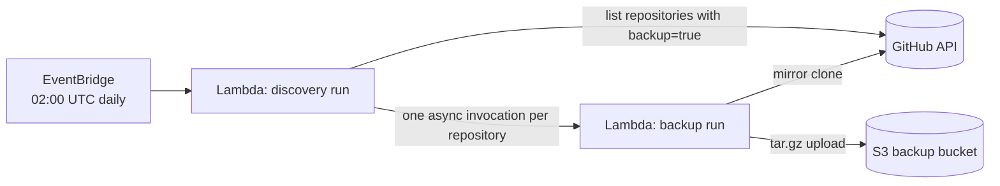

# GitHub repository backup

Opt-in backups of `ministryofjustice` GitHub repositories to S3. Resources are created in production only.

Related work:

- [developer-experience#453](https://github.com/ministryofjustice/developer-experience/issues/453)

## Opting in

Set the repository's `backup` custom property to `true`. Repositories without the property, or with it set to `false`, are not backed up.

## Resources

| File                                                                     | Purpose                                                                    |
| ------------------------------------------------------------------------ | -------------------------------------------------------------------------- |
| [s3-buckets.tf](s3-buckets.tf)                                           | Versioned, KMS-encrypted backup bucket                                     |
| [kms-keys.tf](kms-keys.tf)                                               | Encryption key for the bucket and GitHub App secret                        |
| [secrets-manager.tf](secrets-manager.tf)                                 | Dedicated GitHub App credentials                                           |
| [ssm-parameters.tf](ssm-parameters.tf)                                   | `/github-backup/s3-uri`, used by the standalone backup script              |
| [iam-roles.tf](iam-roles.tf)                                             | GitHub OIDC role for `developer-experience-github-management`              |
| [lambda-functions.tf](lambda-functions.tf)                               | Backup Lambda function and its permissions                                 |
| [eventbridge.tf](eventbridge.tf)                                         | Daily schedule that triggers the Lambda function                           |
| [repository-backup-lambda](repository-backup-lambda)                     | Lambda function source code and tests                                      |

## How the Lambda function runs



1. **Discovery run**: EventBridge invokes the function with an empty event. It pages through `GET /orgs/ministryofjustice/properties/values` and invokes itself asynchronously with `{"repository": "<owner>/<repository>"}` for each opted-in repository.
2. **Backup run**: for a single repository, the function:
   - checks the `backup` property again, in case it changed after discovery
   - creates a mirror of every ref, including `refs/pull/*`, and its reachable history
   - checks object integrity
   - compresses the mirror and uploads it to S3 using the bucket's default KMS encryption

Each repository gets its own invocation, with its own 15-minute timeout and 10 GB of temporary storage, so one failure does not stop the other backups. Concurrency is limited to 5 to protect GitHub API rate limits. Throttled invocations are queued and retried by Lambda, and failed backups are retried once.

Archives are stored at:

```text
s3://<bucket>/<owner>/<repository>/<YYYYMMDD>/<repository>-<UTC timestamp>-<suffix>.tar.gz
```

### Authentication

The function uses the dedicated GitHub App stored in Secrets Manager (`github-backup/github-app`), in line with the [GitHub authentication guidance for automated workloads](https://developer-portal.service.justice.gov.uk/github/github-authentication-for-automated-workloads.html). It signs a short-lived JWT with the App's private key and exchanges it for a one-hour installation token. No personal access token is used.

The App needs:

- read access to repository contents and metadata
- read access to organisation custom properties
- installation on every repository to be backed up

Repositories the App cannot see are not discovered.

### Implementation notes

The Lambda Python runtime does not include Git, so the function uses [dulwich](https://www.dulwich.io/), a pure-Python Git implementation. JWT signing uses the pure-Python [rsa](https://pypi.org/project/rsa/) package, so the deployment package does not depend on the build platform.

## Before first use

1. Replace the `CHANGEME` values in the `github-backup/github-app` secret with `client_id`, `installation_id` and `private_key`.
2. Merge and apply [developer-experience-github-management#69](https://github.com/ministryofjustice/developer-experience-github-management/pull/69).

## Testing

Run the unit tests from this directory:

```bash
cd repository-backup-lambda
# Keep the virtual environment outside the source directory so it is not packaged.
python3 -m venv /tmp/github-backup-venv
/tmp/github-backup-venv/bin/pip install -r requirements.txt boto3
/tmp/github-backup-venv/bin/python -m unittest discover -s tests -v
```

The tests mock GitHub, AWS and Git. They do not check live permissions.

Check the Terraform without using the remote backend:

```bash
terraform fmt -check
TF_DATA_DIR=/tmp/github-backup-tf terraform init -backend=false
TF_DATA_DIR=/tmp/github-backup-tf terraform validate
```

## Running a backup manually

Back up a single repository:

```bash
aws lambda invoke \
  --function-name github-backup \
  --payload '{"repository": "ministryofjustice/<repository>"}' \
  --cli-binary-format raw-in-base64-out \
  response.json
```

Back up every opted-in repository:

```bash
aws lambda invoke --function-name github-backup --payload '{}' --cli-binary-format raw-in-base64-out response.json
```

Logs are in the CloudWatch log group `/aws/lambda/github-backup`.

## Restoring

Use an identity with S3 read and KMS decrypt permissions to download and extract an archive, then check it:

```bash
tar -xzf <archive>.tar.gz
git --git-dir=<repository>.git fsck --full
git clone <repository>.git <working-directory>
```

Do not push a mirror into an existing repository as a test, as this can overwrite or delete refs.

## Limitations

- An invocation cannot run for more than 15 minutes or use more than 10 GB of temporary storage, so very large repositories may not fit.
- Issues, pull request discussions, wikis, release assets, Actions artefacts and Git LFS objects are not backed up.
