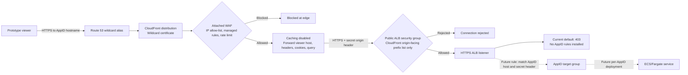

# Shared prototype edge

The `justice-eng-ai/prototypes-infra` component owns one CloudFront distribution,
CloudFront-scope WAF web ACL, and public ALB in each development and production
workspace. Prototype subdomains route through the ALB to independently deployed
ECS/Fargate services. Creating a prototype does not create another distribution,
WAF ACL, or ALB.

## Request flow



Exact Builder and Forge DNS records remain separate from the preview wildcard.
The dashed routes are not provisioned by this shared-edge foundation.

## Configuration and Ownership

The Builder is served at `ai-builder.modernisation-platform.service.justice.gov.uk`,
Forge at `forge.ai-builder.modernisation-platform.service.justice.gov.uk`, and
dynamic prototypes at `<prototype-id>.ai-builder.modernisation-platform.service.justice.gov.uk`.
Each workspace uses its existing public hosted zone: `ai-builder-dev...` in
development and `ai-builder...` in production. The component issues a wildcard
ACM certificate in `us-east-1`, reuses the validation CNAME already maintained
by that workspace's `web-ui` component, and writes the wildcard alias into the
same delegated zone. Exact Builder and Forge records remain authoritative for
their hostnames. The internet-facing ALB uses the existing public prototype
subnets. Its security group allows HTTPS only from CloudFront's origin-facing
managed prefix list. CloudFront authenticates to the origin with a secret header
whose value is stored in Secrets Manager. This requires no VPC RAM share or
networking tfvars configuration.

The edge WAF uses this component's `allowed_ingress_cidrs` variable, which defaults
to the same list as the `web-ui` builder ALB; keep the two in step. There
is no cross-state output dependency. This means the prototypes
share the Builder and Forge UI's existing MoJ GlobalProtect / Prisma Access access
policy. Prototype IDs may begin with digits, as in `336344bc`.

Builder remains at `ai-builder-dev...` / `ai-builder...`; Forge remains at
`forge.ai-builder-dev...` / `forge.ai-builder...`. Prototype previews use
`<AppID>.ai-builder-dev...` or `<AppID>.ai-builder...`. Exact Builder and Forge
records take precedence over the wildcard. CloudFront forwards the viewer host,
cookies, query strings, and headers to the ALB with caching disabled.

Run a reviewed plan and apply through the environments repository workflow in the
matching `justice-eng-ai` `prototypes-infra` workspace. The existing component backend
provides remote state and locking. The `shared_prototype_edge` output exposes the
CloudFront distribution/WAF and shared ALB/listener details needed by per-prototype
infrastructure. The common ALB returns 403 until a prototype-specific host rule
and target group are installed.

## Routing and isolation

- Wildcard Route 53 DNS points preview subdomains to CloudFront. The base zone
  is not published. Exact Builder and Forge records in the same zone take
  precedence over the wildcard.
- CloudFront connects to the public ALB over HTTPS and adds the secret origin
  header. The ALB security group accepts traffic only from CloudFront's
  origin-facing managed prefix list; future AppID listener rules must also
  match the expected origin header before forwarding to a target group.
- CloudFront disables caching and forwards viewer headers, cookies, and query
  strings so dynamic application sessions and host-based routing work.
- The ALB default listener returns 403. No per-prototype listener rules are
  installed by this shared-edge foundation; follow-up work must add rules that
  match each `<AppID>` host and the origin header before forwarding to its ECS
  target group.
- CloudFront does not cache 4xx/5xx responses, so deployment and application
  failures are returned to the caller rather than masked by the shared edge.
- Only IPv4 access is published. WAF blocks clients outside the allowed CIDRs
  before applying common-threat and known-bad-input managed rules. Allowed IPs do
  not bypass those security rules. A shared per-IP limit is 2,000 requests per
  five-minute window; assess this against traffic from shared corporate NATs.
- WAF logs have 30-day retention and redact cookies, Authorization, and query
  strings. Request sampling is disabled because log redaction does not protect
  samples. CloudFront access logging is not configured by this module.

Subdomains provide browser-origin separation, not complete tenant isolation or user
authentication. Keep prototype cookies host-only; never set a shared parent-domain
cookie. Do not host sensitive data or untrusted multi-tenant workloads here without
the appropriate authentication, authorisation, retention and content policies.

## Per-prototype deployment

The shared edge is only the common front door. Follow-up deployment infrastructure
will create an ECS/Fargate cluster and service, target group, and host-based ALB
listener rule for each AppID. The deployment workflow must allocate unique listener
priorities, test the generated infrastructure and app, and remove a prototype's
rule and compute resources when retired. The common CloudFront/WAF/ALB resources
remain in `prototypes-infra` and must not be managed by generated per-prototype
Terraform.

## Generation and Forge integration gates

This PR creates the shared dynamic edge foundation, not the per-prototype ECS
deployment pipeline. Follow-up tickets cover per-AppID ECS/Fargate and ALB
listener-rule Terraform, isolated state/S3 management, generated-infrastructure
tests and SCA, Step Functions orchestration/retries, and GOV.UK Notify status and
completion messages. Keep the common edge state separate from generated
per-prototype infrastructure state.

Forge remains on its existing exact `forge.ai-builder...` URL; prototype preview
hostnames are separate AppID subdomains and route to their own ECS services.

Sharing CloudFront and WAF reduces duplicated edge resources. Costs still include
two environment distributions/WAFs, ALBs, per-prototype ECS/Fargate, logging, and
traffic.

## Local checks

No AWS resources are created by these checks. Mock-provider tests require Terraform
1.7 or later.

```bash
cd terraform/environments/justice-eng-ai/prototypes-infra/shared-prototype-edge
terraform init -backend=false
terraform test
```

Validate the actual component caller from `terraform/environments/justice-eng-ai/prototypes-infra`
with `terraform init -backend=false` and `terraform validate`. Standalone module
validation needs a caller to configure the aliased provider; the Terraform tests
above supply mock providers and create no AWS resources.
